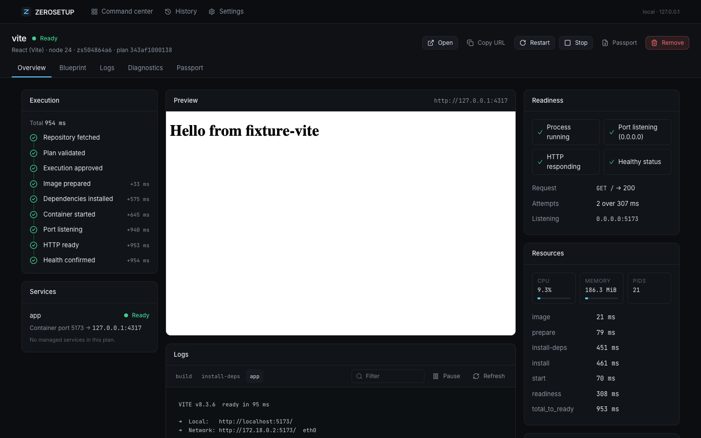

# ZEROSETUP

**From GitHub URL to running application.**

ZEROSETUP looks at a repository **without running it**, works out how to run it, shows you the plan and the evidence behind each choice, and only after you approve that exact plan runs it in a hardened local container. It then checks that the app actually answers HTTP requests before calling it ready.

It is an open-source, local-first way to inspect, run and reproduce supported GitHub projects.



Real output from the CLI, recorded from this repository's fixtures, is in [`docs/demo/`](docs/demo). For example, [a failure, its diagnosis, and the approved repair](docs/demo/cli-03-failure-diagnosis.txt).

## Why it is different

- **It explains every decision.** Each value in the plan is labelled `DETECTED`, `INFERRED`, `DEFAULT`, `USER_OVERRIDE` or `UNSUPPORTED`, with the file and line of reasoning behind it. Conflicting signals (two lockfiles, contradictory Node versions) are shown, not quietly resolved.
- **Approval is bound to a plan hash.** Nothing from the repository, not even `npm install` scripts, runs until you approve the exact SHA-256 of the plan. If the plan changes, you are asked again.
- **"Ready" means it works.** ZEROSETUP tracks *process started → port listening (read from the kernel socket table inside the container) → HTTP responding → healthy* as separate facts. A running container is not reported as a working app.
- **Diagnostics with evidence.** Failures are classified by deterministic rules (loopback-only bind, port mismatch, lockfile drift, missing env var, OOM, crash…). When no rule matches, it says so instead of guessing.
- **Repairs change the plan, never your repo.** A repair (e.g. `HOST=0.0.0.0`) creates a new plan you approve. Repairs can be reverted and are capped at 3 per session.
- **Reproducibility passports and replay.** `zerosetup export` writes a versioned JSON record (schema in [`schemas/`](schemas)) with the commit, base-image digest, lockfile hashes, plan hash, overrides, steps, readiness results and platform. It contains no secrets and no personal paths. `zerosetup replay passport.json` re-resolves the commit and checks manifests, lockfiles, the plan hash, platform and image digests. It reports exactly what still matches before you approve a re-run.
- **Managed services on request.** `--with-service postgres` / `--with-service redis` start official images on a private session network and inject `DATABASE_URL` / `REDIS_URL`. They run non-root with a read-only rootfs and are never published to the host.
- **The CLI and dashboard share one engine.** The local dashboard is a view of the same engine, with live event streams.

## Supported today

Every row below passes an automated integration test against a real Docker engine (`make test-integration`, macOS arm64, Colima / Docker 29.5.2).

| Stack | Detected from | Package managers / modes | Integration fixture |
|---|---|---|---|
| Vite (React/Vue/Svelte) | `vite` dependency | npm · pnpm · dev · production (`vite build` + `vite preview`) | ✅ `vite`, `vite-pnpm` |
| Next.js | `next` dependency | npm · dev · production (`next build` + `next start`) | ✅ `nextjs` |
| Express / plain Node.js HTTP | `express` / `start` script / entry file | npm · yarn 1 · Yarn 4 (`nodeLinker: node-modules`) | ✅ `express`, `express-yarn`, `express-yarn-berry` |
| Monorepo workspaces | `workspaces` / `pnpm-workspace.yaml` + `--workspace <dir>` | npm · pnpm · yarn 1 | ✅ `monorepo-npm`, `monorepo-pnpm`, `monorepo-yarn` |
| FastAPI | `fastapi` in requirements.txt / pyproject | pip · uv | ✅ `fastapi`, `fastapi-uv` |
| Flask | `flask` + `app = Flask(...)` | pip · dev server · production with gunicorn | ✅ `flask`, `flask-gunicorn` |
| Django | `django` + `manage.py` | pip · `runserver` · production with gunicorn (migrations never run automatically) | ✅ `django`, `django-gunicorn` |
| PostgreSQL / Redis (managed) | `--with-service` only | official images, non-root | ✅ `express-services` |
| A real GitHub repository | `https://github.com/...` pinned to a commit | npm (no lockfile) | ✅ Vite's official React template |
| Yarn Plug'n'Play, Yarn 2+ workspaces, Bun, Poetry, Pipenv | recognised | — | ❌ reported as unsupported, with the reason |
| Dockerfile / Compose / Dev Container | parsed and risk-flagged | — | ❌ analysed, never executed |

**Host platforms:** tested on macOS Apple Silicon. Go unit tests also pass on Linux arm64 (run in a container). Linux Docker integration runs in CI but hasn't run yet. macOS Intel and Windows compile but are untested (Windows is experimental).

## Install

Release binaries aren't published yet. Build from source (Go ≥ 1.26, Node ≥ 20.19):

```bash
git clone <this repository> && cd zerosetup
make dashboard-deps build      # builds dashboard + bin/zerosetup
./bin/zerosetup doctor
```

You need a container engine: Docker Desktop, OrbStack, Colima (`brew install colima docker && colima start`), or Docker on Linux. Inspection works without one.

## Quick start

```bash
zerosetup doctor                                   # host checks
zerosetup inspect https://github.com/owner/repo    # read-only analysis
zerosetup plan    https://github.com/owner/repo    # full plan + hash
zerosetup run     https://github.com/owner/repo    # approve → build → verify
zerosetup ps                                       # sessions, reconciled with Docker
zerosetup logs   <session> -f
zerosetup export <session> -o passport.json
zerosetup stop   <session> && zerosetup remove <session>
zerosetup replay  passport.json                    # check a passport, prepare a re-run
zerosetup dashboard                                # local UI on 127.0.0.1
```

Useful flags: `--ref <branch|tag|sha>`, `--mode production`, `--workspace apps/web`, `--with-service postgres|redis`, `--port`, `--runtime-version`, `--script`, `--env KEY=VALUE`, `--secret NAME` (prompted, never stored), `--memory`, `--cpus`, `--ready-path`, `--json`.
For scripts: `zerosetup run <src> --approve <plan-hash>` approves **only** that plan.

## How execution works

```
source → inspect (no execution) → plan (versioned, hashed) → policy check → YOUR APPROVAL
      → pull official image (digest recorded) → copy source into a ZEROSETUP volume
      → install steps, each in its own hardened container → start app
      → socket check inside the container → HTTP check → READY
```

Every container runs as uid 1000 with all Linux capabilities dropped, `no-new-privileges`, a read-only root filesystem, CPU/memory/PID limits and rotated logs. There are **no host bind mounts**, the Docker socket is never mounted, and previews are published on `127.0.0.1` only.

## Security model, honestly

Read [docs/THREAT_MODEL.md](docs/THREAT_MODEL.md). In short:
- Containers are **not** a strong boundary against hostile code. Treat unknown repositories as unsafe.
- Outbound network is **not** filtered, because installs need it. Installed code can reach the internet and your LAN.
- Inspection never executes repository code. Existing Dockerfiles, Compose files and Dev Container specs are analysed, but never run.
- The dashboard API binds to loopback, requires a per-process token, and rejects foreign `Host` and `Origin` headers.

## Documentation

[Architecture](docs/ARCHITECTURE.md) · [Decisions](docs/DECISIONS.md) · [Threat model](docs/THREAT_MODEL.md) · [Implementation status](docs/IMPLEMENTATION_STATUS.md) · [Known limitations](docs/KNOWN_LIMITATIONS.md) · [Roadmap](docs/ROADMAP.md) · [Development](docs/DEVELOPMENT.md) · [Contributing](docs/CONTRIBUTING.md) · [CLI reference](docs/CLI.md) · [Isolation design](docs/ISOLATION.md) · [Research & positioning](docs/RESEARCH.md)

## Contributing

Detectors are small Go types implementing `detect.Detector`. See [docs/CONTRIBUTING.md](docs/CONTRIBUTING.md#adding-a-detector). Report bugs with `zerosetup status <id> --json` output and the passport. Security issues: see [SECURITY.md](SECURITY.md).

## License

MIT. See [LICENSE](LICENSE).
